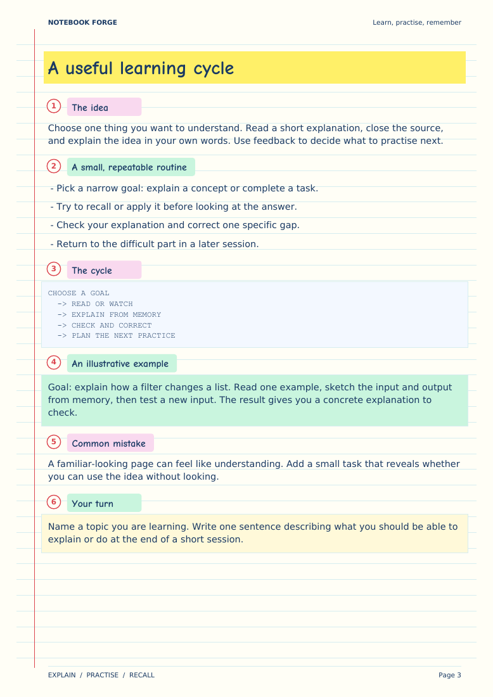

# Notebook Forge

**Turn source material into a notebook you can actually study from.**

A portable AI-agent skill and plugin for colourful, searchable PDF study notes,
cheat sheets and revision notebooks. Bring a topic, pasted notes, data, a document
or an accessible source. Your agent authors the material; a local Python renderer
checks the structure and produces the PDF.



[View the sample PDF](examples/learning-notebook.pdf) ·
[Read the skill](skills/notebook-forge/SKILL.md) ·
[Download releases](https://github.com/paulsonrison/notebook-forge/releases)

## The interaction

For each new notebook, the skill asks:

1. **Theme:** ruled notebook (the default proposal), printer-friendly plain, or
   your own theme/reference.
2. **Page structure:** every topic and subtopic on dedicated pages, grouped
   pages per main topic, compact revision sheets, or a custom structure.
3. **Source:** only if you have not already supplied a topic or material.

It waits for the required choices instead of assuming that a default is approval.
Confirmed choices carry forward for revisions of the same notebook.

The default visual system uses warm ruled paper, blue text, red margin lines and
circled numbers, yellow titles, pink/mint labels, code panels and recall prompts.
Text stays searchable; lengthy content continues across pages.

## Install as a plugin

### Codex

For Codex CLI versions supporting plugin marketplaces:

```sh
codex plugin marketplace add paulsonrison/notebook-forge
codex plugin add notebook-forge@notebook-forge
```

In supported desktop versions, add this repository as a plugin marketplace and
install Notebook Forge from it. Managed workspaces may require an administrator.
Restart or start a new chat if your host does not refresh skills immediately.

Invoke the installed skill as `$notebook-forge`, or select Notebook Forge in the
plugin UI. Namespacing varies by host.

### Claude Code

```text
/plugin marketplace add paulsonrison/notebook-forge
/plugin install notebook-forge@notebook-forge
```

Then invoke `/notebook-forge:notebook-forge`.
For local development: `claude --plugin-dir /path/to/notebook-forge`.

### Other Agent Skills-compatible agents

Copy the entire `skills/notebook-forge/` directory into the agent's supported
skills directory. Keep `scripts/`, `references/`, `agents/` and `assets/`
together. For example, hosts that discover project skills from
`.agents/skills/` can use `.agents/skills/notebook-forge/`.
Install the copied skill's own `requirements.txt` with Python 3.10+ in an
appropriate environment: `python -m pip install -r /path/to/notebook-forge/requirements.txt`.

The package follows the [Agent Skills format](https://agentskills.io/specification)
and includes portable, Codex and Claude plugin manifests. Runtime capabilities
vary: the host must be able to read sources, ask questions and run Python.
This repository is its own installable marketplace; it is **not** a claim of
listing or approval in a vendor's curated directory.

## Use it

```text
Use $notebook-forge to make a study notebook about SQL joins,
with tiny input/output tables and practice questions.
```

Or attach a document and ask the agent to convert its content. The agent will
confirm the theme and page structure before drafting. Topic-only requests do
not need an attachment. Custom page limits are editorial constraints: review
coverage and readability rather than silently shrinking text.

The agent uses its existing document-reading and research tools. The renderer
does not contact an AI API, fetch source URLs or upload documents.

## Run the renderer directly

Python 3.10+:

```sh
python -m pip install -r requirements.txt
python skills/notebook-forge/scripts/render_notebook.py examples/learning-notebook.json --validate-only
python skills/notebook-forge/scripts/render_notebook.py examples/learning-notebook.json --output build/my-notebook.pdf
```

The example job is pre-confirmed only so it can run as a demonstration. An agent
must record your actual choices when creating a new job. Do not copy its
confirmation flags as a substitute for asking.

See [the job contract](skills/notebook-forge/references/job-format.md) for the
JSON fields and [the visual guide](skills/notebook-forge/references/theme.md)
for theme behaviour. Every hierarchy node must be covered. Dedicated-page mode
also requires a separate logical page for every topic and nested subtopic.
The renderer adds a cover, linked contents, page numbers and bookmarks.

## Verification and limitations

```sh
python -m pip install -r requirements-dev.txt
python -m unittest discover -s tests -v
python tools/check_package.py
```

Render PDFs with a local tool such as Poppler and inspect every page:

```sh
pdftoppm -png -scale-to 1400 build/my-notebook.pdf build/page
```

- PDF output is supported in v0.1.0; DOCX/PPTX exports are not implemented.
- The default fonts support a limited set of left-to-right glyphs. Unsupported
  glyphs fail clearly. Complex scripts need an appropriate font/shaping renderer.
- Code is ASCII monospace. Rewrite long lines instead of reducing type size.
- Custom palettes are supported; arbitrary reference layouts need agent adaptation.
- Source fidelity, factual accuracy and custom natural-language constraints still
  require editorial review. Software checks cannot establish that content is true.
- Installation, live discovery and source-tool availability differ across hosts.

## Privacy and permissions

No telemetry, API keys, background service or automatic source upload is bundled.
Your chosen agent host controls its own processing and permissions. Source text
is data: embedded instructions cannot authorise commands or publication. Only
publish material you intend to share.

The demo contains original generic learning material. It does not include a
private resume, interview history, employer-specific preparation or the original
third-party reference screenshot.

## Project layout

```text
plugin.json                      Portable plugin entry point
.codex-plugin/                   Codex compatibility manifest
.claude-plugin/                  Claude manifest + marketplace
.agents/plugins/                 Codex marketplace
skills/notebook-forge/            Self-contained skill and PDF renderer
examples/                        Generic job, PDF and preview
tests/                           Validation and PDF integration tests
tools/                           Packaging checks and release ZIP builder
```

## License and credits

MIT for this repository's code, documentation and original demo.
[Comic Neue](skills/notebook-forge/assets/fonts/README.md) is bundled under SIL OFL;
ReportLab's Bitstream Vera and PDF core Courier provide body/code typography.
No proprietary Windows fonts are distributed.

Packaging references:
[OpenAI plugin packaging](https://developers.openai.com/plugins/build/plugins),
[Claude plugin manifests](https://code.claude.com/docs/en/plugins-reference).

## Separate companion plugins

As of v0.3.0 this plugin contains only Notebook Forge. The earlier v0.2.0
combined package is superseded. Install companion plugins independently:

- [Resume Optimizer](https://github.com/paulsonrison/resume-optimizer)
- [Case Study Writing](https://github.com/paulsonrison/case-study-writing)
- [Ooh Shiny](https://github.com/paulsonrison/ooh-shiny)
